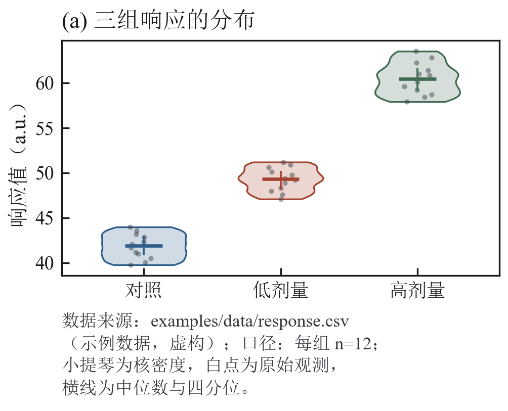
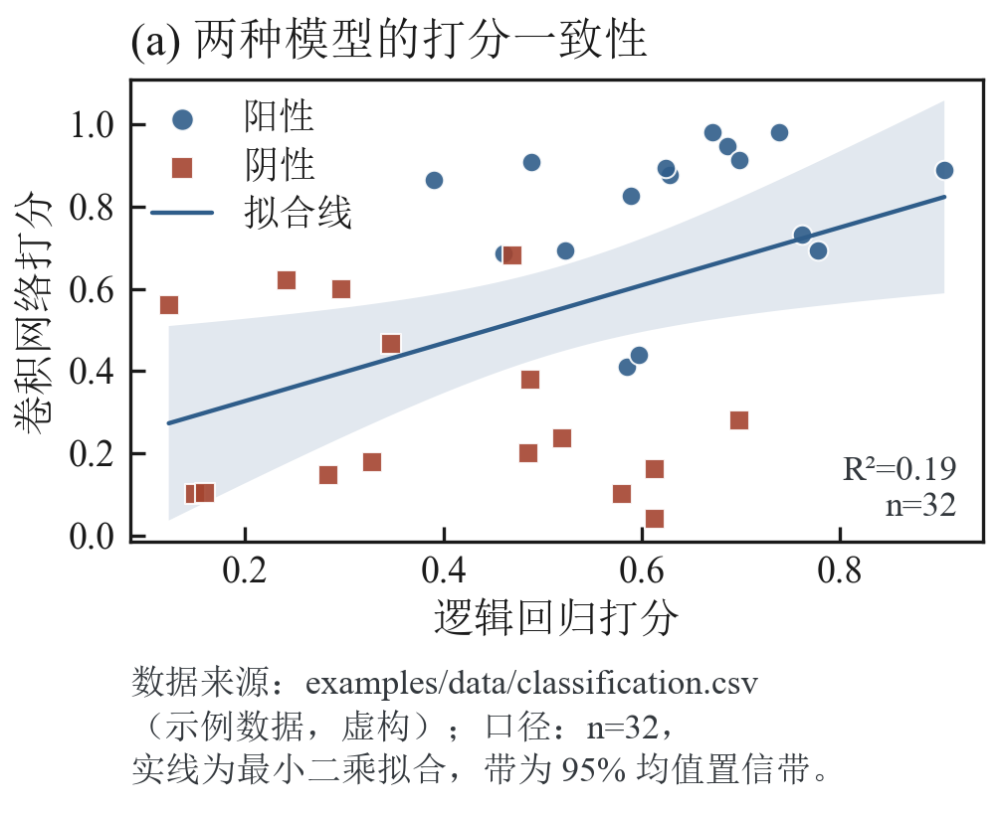
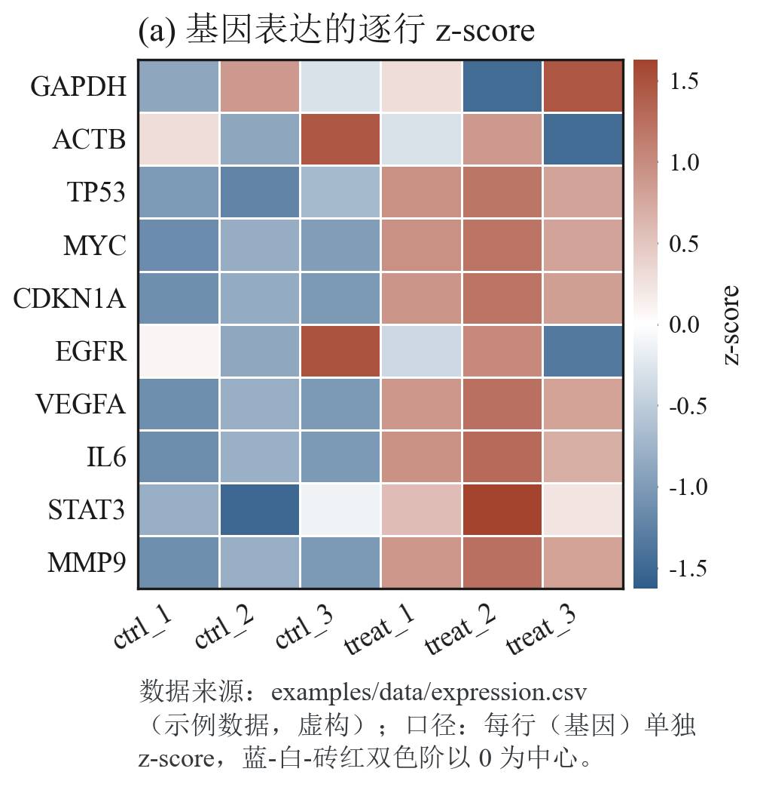
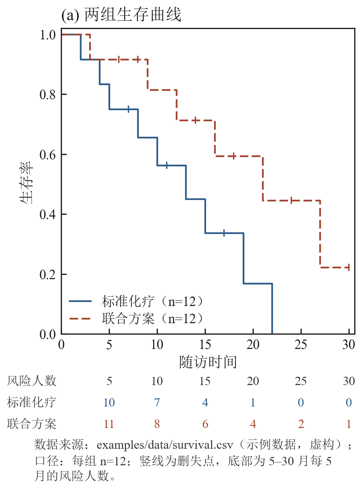

# academic-figures · 中文论文插图（简单高级框架风）

[](https://github.com/pordlm/py-academic-fig-skill/actions/workflows/ci.yml)

把「论文里要一张图」变成**可复现的代码 + 可投稿的产物**：白纸、墨线、细框、
低饱和强调色、充足留白——像框架图，不像数据看板，也不像 AI 海报。

- 一次 `apply_theme()`，之后**任何** matplotlib 代码都自动是这个风格（不限于本仓库的渲染器）。
- 26 个现成渲染器，两类签名（别混用）：数据图 21 个
  `(ax=None, <位置数据参数>, *, …) -> ax`（也接受 `data=` 关键字，`ax` 可省）；
  示意图 5 个 `diagram(spec, *, width=…, …) -> ax`（自己开画布，**不接收** `ax`）。
- PNG(300 dpi) + PDF(矢量，字体嵌入) 双出，写盘后**自动体检**（dpi/宽高比/命名）。
- 中文字体自动回退（Windows 优先），并静态拦「中文 + `$…$` 混排」这个方框高发区。
- 一条命令自检：`python -m academic_fig.cli check --dir examples/out --strict`。


> 上面这张就是 `examples/render_showcase.py` 的输出：六个面板共用一套色板与线宽，
> 图注统一写「数据来源 + 口径」。

---

## 30 秒上手

```python
import matplotlib; matplotlib.use("Agg")     # 服务器/无 GUI 必须；要在 pyplot 之前
import academic_fig as afg

afg.apply_theme()                            # ① 主题：白底、无网格、中文字体、300dpi、PDF 嵌入
fig, ax = afg.paper_fig("single")            # ② 画布：单栏 3.35in（双栏用 "double" = 7.0in）
afg.plots.bar(ax, ["对照", "低剂量", "高剂量"], [41, 49, 60],
              errors=[1.6, 2.3, 2.4], highlight=[2], ylabel="响应值（a.u.）")   # ③ 画
afg.panel(ax, label="(a)", title="组间响应差异")                                  # ④ 标
afg.footnote(fig, "数据来源：示例数据；口径：柱为均值，误差棒为 ± 1 SD（n=12）。")   # ⑤ 注
afg.save(fig, "fig01_response")              # ⑥ 出图：fig01_response.png + .pdf
```

六行里只有第 ③ 行随图型变化，其余五行**永远是这五步**。
`save()` 会自动建目录、按 `figNN_名称` 命名、并在写盘后核对 dpi 与宽高比。

返回值是「格式键 + 两个诊断键」的字典，看清类型再用：

```python
paths = afg.save(fig, "fig01_response")
# {'png': WindowsPath(...), 'pdf': WindowsPath(...),      ← 恒为 Path
#  'auto_theme': True, 'font_retrofit': 41}               ← 诊断用 bool / int

for p in afg.figure_paths(paths).values():   # 只关心路径时先过这一层
    print(p.name)
```

`auto_theme` 告诉你「这张图的主题是不是库替你兜的」（漏了 `apply_theme()` 时为 `True`，
显式调用过则为 `False`）；`font_retrofit` 是本次被改写到中文字体栈的文字个数
（`0` 表示一个没动——你自己套过主题，或主题在写字之前就套好了）。

---

## 安装

本 skill 就是一个 Python 包（`academic_fig/`）+ 提示词库（`prompts/`）+ 文档（`references/`）。
四种装法，按需选（AI 用 0/A/B，代码调用用 P）。

### 方式 0：装进 DSH（skill 插件，一条命令）

本仓库同时是一个 DSH bundle（`package.json` 里的 `dsh.bundle` + `cordis.patch.yml` + `index.js`）：
装上后 `SKILL.md`、`prompts/`、`references/` 会直接进 DSH 的技能目录，AI 自己就能按本 skill 出图。

```bash
dsh plugin add https://github.com/pordlm/py-academic-fig-skill
```

它注册的是**技能**，不是 UI 插件，装完在插件列表里叫 `academic-figures`。Python 侧仍要装依赖才能真的渲染：

```bash
pip install numpy matplotlib          # 想直接传 DataFrame 再加 pandas
```

### 方式 P：只装 Python 库（`pip install`，不含 skill 资产）

```bash
pip install git+https://github.com/pordlm/py-academic-fig-skill   # 或 pip install -e <仓库根>
afig list                                                         # 验证命令行可用
```

这条路径**只装 Python 包**（`academic_fig` + `afig` 命令，约 1 MB）：

| 装法 | 得到什么 | 拿不到什么 |
| --- | --- | --- |
| `dsh plugin add`（方式 0） | `SKILL.md` + `prompts/` + `references/` + 代码，AI 可直接按 skill 出图 | 不装 numpy/matplotlib，要自己 `pip install` |
| `install_skill.py`（方式 A/B） | 同上，落到 `~/.dsh/skills/academic-figures` | 同上 |
| `pip install`（方式 P） | `import academic_fig`、`afig` 命令，可在任何脚本里画图 | `SKILL.md`/`prompts/`/`references/`/`assets/` 不在 wheel 里（`include-package-data = false`），需要提示词库时请用方式 0/A/B 或直接读仓库 |

两种角色可以并存：`pip install` 供代码调用，`dsh plugin add` 供 AI 调用，互不覆盖。

### 方式 A：复制安装（推荐，装完可脱离本仓库）

```bash
cd <本仓库根>
python scripts/install_skill.py                 # 默认装到「仓库上级目录」的 .dsh/skills/academic-figures
python scripts/install_skill.py --dry-run       # 只看计划（含将删掉的陈旧文件），不写盘
python scripts/install_skill.py --force         # 升级旧安装：原地覆盖 + 清理陈旧文件
python scripts/install_skill.py --target ~/.dsh/skills/academic-figures   # 显式指定（用户级）
```

**默认装到哪里**：`<仓库的上级目录>/.dsh/skills/academic-figures`（本机就是
`D:\paper\.dsh\skills\academic-figures`），即 DSH 扫描的项目级 skill 根。
脚本**拒绝把目标落在仓库自己的目录树里**——那样只会得到一份 DSH 不会扫描的嵌套副本，
真正生效的那份仍停在旧版本。显式 `--target` 指到仓库内会报错退出（退出码 1）并提示换位置：

```text
[x] 拒绝把 skill 装进仓库自己的目录树：<仓库>\.dsh\skills\academic-figures
    装在仓库里只会得到一份 DSH 不会扫描的嵌套副本，真正生效的那份仍停在旧版本。
    换一个位置：--target "D:/paper/.dsh/skills/academic-figures"
```

脚本会先校验 `SKILL.md` 的 frontmatter（`name` 必须是 kebab-case 且与安装目录名一致、
`description` 非空），再复制 `academic_fig/ prompts/ references/ examples/ assets/ SKILL.md README.md BUILD.json`。
**重复执行是幂等的**：文件指纹一致时只说「已是最新」，不动目标目录。

⚠️ **目标目录已存在旧版时，首装会被拒绝**（防止误删别人的安装），退出码 1，信息是：

```text
[x] 目标目录已存在旧版本：…/.dsh/skills/academic-figures
    它与当前源码不一致（安装指纹 21637e5c823f… ≠ 当前 f8c2331a9c94…），所以默认不覆盖——避免把别人改过的 skill 悄悄冲掉。
    升级：加 --force（原地覆盖，并按清单删掉源码里已不存在的陈旧文件；
    你自己往目标目录里放的文件不动）；
    只想先看计划：加 --dry-run（不写盘，会列出将覆盖与将删除的文件）；
    想彻底重来：先手动删掉该目录再跑一次。
```

升级旧版就是照着最后几行办——先 `--dry-run` 看要覆盖什么、要删什么，再加 `--force`：

```bash
python scripts/install_skill.py --dry-run        # 演练：[dry] 会写入 127 个文件 / 会删除 N 个陈旧文件
python scripts/install_skill.py --force          # 覆盖旧安装（等价于「刷新到当前 build」）
```

**`--force` 会清理陈旧文件**：升级时按 `.install-manifest.json` 的清单修剪「上次装过、这次源码里已没有」
的文件，并顺手删掉因此变空的子目录；你自己往目标目录里放的文件不在清单里，不会被删。
清单是目标目录里的普通文件，所以修剪是**保守**的：每条路径先过词法检查（绝对路径、盘符、
`..` 一律拒绝），再用真实路径确认它仍在安装目录内（挡住「中间目录是指向外部的链接」）；
清单损坏或来自没有 `paths` 字段的旧版本时**一条都不删**，只打印告警——清干净永远排在
「不误删」之后。这样升级后的副本与仓库逐字节一致，不会出现「源码删了图、安装副本还留着，
`cli check` 却查不到」的假绿。

复制安装会一并带上 `LICENSE`（GPL 要求分发时附许可证全文）。

每次安装结束都打印两行，方便一眼核对仓库与副本是不是同一版：

```text
[4/4] 完成（copy，127 个文件）
build=<version>+YYYYMMDD-HHMM
目标：D:\paper\.dsh\skills\academic-figures
```

### 方式 B：链接安装（改代码立刻生效，适合边改边用）

```bash
python scripts/install_skill.py --junction      # Windows: mklink /J（无需管理员）；Linux/macOS: symlink
```

目标目录直接指向本仓库，`git pull` 之后不用重装。

### 只想在某个项目里临时用

```python
import sys; sys.path.insert(0, r"D:/path/to/academic-figures")
import academic_fig as afg
```

或

```bash
pip install -e D:/path/to/academic-figures
```

依赖只有 **numpy + matplotlib**（Python ≥ 3.10）。`pandas` 可选：装了能直接传 DataFrame，
没装时所有示例走标准库 `csv`。

---

## 风格约定（这就是"像不像"的全部）

| 维度 | 取值 | 谁在保证 |
|---|---|---|
| 背景 | 纯白 `#FFFFFF`，无网格、无阴影 | `apply_theme()` |
| 坐标框 | 四边可见、0.8 pt、墨色 `#1A1A1A` | `style_axes(ax)` |
| 刻度 | 朝内，主刻度 3.5 pt / 次刻度 2.0 pt，标签 9 pt | `style_axes(ax)` |
| 字号 | 标题 11（normal）· 轴标签 10 · 刻度/图例 9 · 图注 8.5 | `typography.TEXT_SIZES` |
| 宽度 | 单栏 3.35 in / 双栏 7.0 in；宽高比 0.6–2.6 | `paper_fig()` / `save()` |
| 配色 | 只用 `palette.py` 的语义色；禁 `tab10/jet/rainbow` | `checks.py` |
| 图例 | 无边框、9 pt、`labelspacing=0.35`、自动避开数据 | `legend(ax, loc="auto")` |
| 导出 | PNG 300 dpi + PDF `fonttype=42`（SVG 可选 `fonttype=none`） | `save()` |

改主题只改一处：`afg.apply_theme(font_size=10, palette="paper-calm", cjk=True)`。

换配色方案**目前只能换框架色**：`apply_theme(palette="journal-cns")` 会改
墨色/灰阶/底色，并重写 `axes.prop_cycle`（所以裸 `ax.plot` / `ax.bar` 的循环色跟着变）；
但 `afg.plots.*` 里的语义色（GOOD/BAD/基线/高亮）与 `cmap_seq/div/disc` 色阶
**始终取 `palette.py` 的 paper-calm 常量**，不会跟着方案走。想要另一套语义色，
目前需要改 `palette.py`（冻结文件，需团队同意），见「已知限制」。

---

## 目录结构

```
academic-fig-skill/
├── SKILL.md                 # skill 入口（DSH 读它的 frontmatter 决定何时唤醒）
├── README.md                # 本文件
├── screenshots.json         # 市场展示图顺序（插件市场读它，不写就从 README 抓图）
├── academic_fig/            # 框架本体（只依赖 numpy + matplotlib）
│   ├── palette.py           # 冻结色板：墨/纸/6 强调色/语义色/3 套色阶
│   ├── typography.py        # 字体回退、字号白名单、中文+$混排检测
│   ├── style.py             # apply_theme / style_axes / legend / refline / threshold …
│   ├── layout.py            # paper_fig / grid_axes / panel / footnote（折行+加高）
│   ├── export.py            # save（PNG+PDF+SVG，写盘后体检）
│   ├── checks.py            # check_dir / check_script / Issue（结构化自检）
│   ├── cli.py               # python -m academic_fig.cli check|list|init
│   ├── plots/               # 21 个数据图渲染器 + base 原语
│   └── diagrams/            # 5 个示意图渲染器（architecture/flow/field/geometry/gate）
├── prompts/                 # 中文提示词库（22 个文件 + index.json 机读索引）
├── references/              # 7 篇说明：期刊规格/中文排版/雷区/选图/配色/R 对照/为何不用位图
├── scripts/install_skill.py # 一键安装（复制 / 链接 / 演练 / 幂等）
├── scripts/check_prompt_skeletons.py # 提示词骨架门：把 prompts/*.md 的 Python 块真跑一遍
├── examples/
│   ├── render_plots.py      # 21 张数据图，一条命令跑完 → examples/out/<大类>/
│   ├── render_showcase.py   # 六面板样张 → assets/style_preview.png
│   └── data/                # ≤20KB 演示数据（csv/json），物理上合理
├── assets/                  # 风格样张 + atlas/ 精选参考图（单张 PNG ≤ 600 KB）+ icon-180.png
└── docs/                    # 架构说明、图表词典
```

---

## API 速查

核心 7 个：

| 函数 | 签名 | 作用 |
|---|---|---|
| `apply_theme` | `(palette="paper-calm", cjk=True, font_size=10)` | 设全图 rcParams（白底/无网格/字体/字宽/导出） |
| `paper_fig` | `(width="single", height=None, ncols=1, nrows=1, **kw) -> (fig, axes)` | 按期刊宽度建画布，返回 fig 与 axes |
| `panel` | `(ax, label="(a)", title=None, xlabel=None, ylabel=None) -> ax` | 面板标签 + 标题 + 轴标签（幂等） |
| `footnote` | `(fig, text, **kw) -> Text` | 图注：按渲染宽度折行，必要时把画布加高 |
| `save` | `(fig, base, formats=("png","pdf"), dpi=300) -> dict[str, Path]` | 导出 + 体检，返回文件路径 |
| `palette` | 模块 | 色值与色阶（`cmap_seq/div/disc`、`tint`） |
| `plots` | 模块 | 21 个数据图渲染器 + `base` 原语 |

图元（让手写代码也合规）：`style_axes · axes · legend · refline · reference_circle ·
threshold · annotate_point · shade_region · square · grid_axes · panel_note · save_all`。

自检：`check_dir · check_script · check_text · has_errors · Issue`。
常量：`SINGLE=3.35 · DOUBLE=7.0 · WIDTHS`。

**兼容别名**（老脚本原样能跑）：`set_paper_style → apply_theme`、`style_axes → axes`、
`save_paper_figure → save`、`footnote_wrapped → footnote`、`panel_result → panel_note`、
`plot_reference_circle → reference_circle`。

---

## 数据图：21 个渲染器 / 10 个大类

<!-- cat-table:start -->
| 大类 | 渲染器 | 提示词 | 用来画什么 |
|---|---|---|---|
| 比较与组成 | `bar` `grouped_bar` `stacked_bar` `lollipop` | `prompts/30_cat_compare.md` | 比较与组成类 |
| 趋势与时序 | `line` `area` | `prompts/30_cat_trend.md` | 趋势与时间序列类 |
| 分布与描述统计 | `violin` `box` `hist` | `prompts/30_cat_dist.md` | 分布与描述统计类 |
| 关系与回归 | `scatter` `corr` | `prompts/30_cat_relation.md` | 关系与回归类 |
| 假设检验与 Meta | `forest` | `prompts/30_cat_inference.md` | 假设检验与 Meta 分析类 |
| 机器学习与模型评估 | `roc` `pr` `confusion` | `prompts/30_cat_ml.md` | 机器学习与模型评估类 |
| 降维与多维 | `pca` `radar` | `prompts/30_cat_dimred.md` | 降维与聚类类 |
| 临床与生存分析 | `km` | `prompts/30_cat_clinical.md` | 临床医学与生存分析类 |
| 组学与生物信息 | `volcano` `heatmap` | `prompts/30_cat_omics.md` | 生物信息与组学类 |
| 流程与流向 | `sankey` | `prompts/30_cat_flow.md` | 流程与网络类 |
<!-- cat-table:end -->

渲染器的统一约定：

```python
ax = afg.plots.line(ax, years, series, ylabel="准确率（%）")   # 传 ax 就画在 ax 上
ax = afg.plots.line(years, series)                            # 不传就自建 fig（第一个位置参数是 ax）
fig = ax.figure                                               # 两种写法都能拿到 fig
```

- 数据可以用位置参数，也可以 `data={...}`；长度不符/空数据会抛**清晰的 `ValueError`**。
- 只用 `palette` 的颜色；数值标签只标极值/关键点；不画网格。
- 每个渲染器的 docstring 写了「这张图要让读者看到什么」+ 3 条该类的塌陷点提醒。

```bash
python -m academic_fig.cli list                 # 看全部图型与用法
python -m academic_fig.cli list --category ml   # 只看某一类
```

---

## 示意图：5 个渲染器

| 类 | api | spec 关键字段（真实键名） | 示例产物 |
|---|---|---|---|
| 框架与结构 | `afg.diagrams.architecture(spec, width="double")` | `layers=[{name, note, nodes:[{label, note, highlight}]}]`、`links=[{from, to, label}]`、`auto_cols`、`route` | `examples/out/diagrams/fig01_arch_layers.png` |
| 流程与时序 | `afg.diagrams.flow(spec)` | `direction="v"/"h"`、`lanes`、`nodes=[{id, kind, row, col, label}]`、`edges=[{from, to, label}]` | `examples/out/diagrams/fig03_flow_vertical.png` |
| 场量与响应面 | `afg.diagrams.field(spec, kind="surface3d")` | `kind`（`contourf`/`contour`/`both`/`surface3d`/`scatter`）、`x/y`（`{min,max,n}`）、`field`、`labels`、`levels` | `examples/out/diagrams/fig05_field_gaussian.png` |
| 几何与覆盖 | `afg.diagrams.geometry(spec)` | `x/y`（含 `label`/`unit`）、`regions`、`circles`、`stations`、`keypoints`、`scale_bar` | `examples/out/diagrams/fig07_geometry_coverage.png` |
| 门限与权衡 | `afg.diagrams.gate(spec)` | `kind="pareto"/"band"`、`cloud`、`pareto`、`thresholds`、`runs`、`ideal` | `examples/out/diagrams/fig09_gate_pareto.png` |

它们都返回 `ax`（`ax.figure` 可直接交给 `afg.save`），**不吃 `ax` 参数**——示意图
自己建整幅图（版式要先算，和 `paper_fig` 的固定网格冲突）。spec 也可存成 JSON 复用：
`examples/data/diagrams/*.json` 是最小样例。`architecture()` 会先算版式，
高度装不下会直接报「至少需要 4.26in」，而不是画出重叠的框。
下表五段都在 `examples/readme_diagram_examples.py` 里原样跑（产物 `examples/out/readme/`）。

```python
import json, academic_fig as afg

afg.apply_theme()                     # 一定先套风格，否则中文全是方框
spec = json.load(open("examples/data/diagrams/arch_layers.json", encoding="utf-8"))
ax = afg.diagrams.architecture(spec, width="double",
                               note="数据来源：自绘；口径：模块仅表层级关系")
afg.save(ax.figure, "fig05_framework")          # → fig05_framework.png/.pdf（单栏宽）
```

---

## 提示词库怎么用

`prompts/` 是给**模型**看的规范，不是给代码 import 的。组织方式是「按大类」：
先读全局系统提示词，再用 `10_intake.md` 把需求收口，然后按图类读对应的 `30_cat_*.md`
（示意图读 `40_diagram_*.md`），最后用 `50_negative.md` + `60_rubric.md` 自检。

`prompts/index.json` 是机器索引，把「大类 → 提示词文件 → 该用哪些 api」串起来。
**不要在代码里硬编码提示词文件名**，读 `index.json` 即可：

```python
import json
idx = {it["category"]: it for it in json.load(open("prompts/index.json", encoding="utf-8"))}
entry = idx["ml"]
print(entry["file"], entry["api"])     # prompts/30_cat_ml.md  ['academic_fig.plots.roc', …]
```

**骨架门（改完提示词必须跑）**：`prompts/*.md` 里每段 ```` ```python ```` 都是**可执行模板**。
`scripts/check_prompt_skeletons.py` 把它们逐段抽到临时目录真跑一遍（缺 `apply_theme()` 自动补、
`examples/data/` 一起拷进去），判据是 `rc==0` 且 stderr 里没有「缺字形 / 公式语法错 / TypeError」：

```bash
python scripts/check_prompt_skeletons.py                 # 全绿 exit 0；失败逐条打印 文件:行 → rc → 首错行
python scripts/check_prompt_skeletons.py --list          # 只列骨架，不执行
python scripts/check_prompt_skeletons.py --only 30_cat_omics --keep   # 单篇排查，保留现场
```

编造 spec 键、写不存在的 `ax=` 参数、`$...$` 里夹中文，都会当场红——不用等复评。实在跑不了的
骨架在脚本的 `EXEMPT` 里显式登记「文件名: 原因」，**默认必须能跑**，不用「跳过」掩盖。
它和 `diagrams/_guard.py`（未 `apply_theme` 自动补、未知 spec 键 ValueError）是一对：
`_guard` 管运行时，这道门管文档里的示例。

---

## 图表词典覆盖度（`docs/图表词典.md` 的 14 大类）

<!-- coverage-table:start -->
| 词典大类 | 直接支持 | 没有专属渲染器时怎么办 |
|---|---|---|
| 1 基础比较与组成 | bar · grouped_bar · stacked_bar · lollipop | 帕累托/瀑布/环形等手写，`style_axes` 兜底 |
| 2 趋势与时间序列 | line · area | 阶梯/事件图/甘特用 `line(step=…)` 或手写 |
| 3 数据分布与描述统计 | violin · box · hist | ECDF/雨云/山脊用 `hist`/`violin` 组合或手写 |
| 4 变量关系与回归 | scatter · corr | 气泡/Hexbin/Q-Q 手写（`scatter` 换 marker 大小即可） |
| 5 假设检验与 Meta | forest | 漏斗图/系数图手写（`annotate_point` + `refline`） |
| 6 机器学习与模型 | roc · pr · confusion | 校准/学习曲线/特征重要性手写（`line` + `bar`） |
| 7 多维与降维 | pca · radar | 碎石图/平行坐标/树状图手写；t-SNE/UMAP 传入二维坐标即可 |
| 8 临床与生存 | km | 游泳道/累积发病率手写；PRISMA 用 `diagrams.flow` |
| 9 组学与生物信息 | volcano · heatmap | MA/曼哈顿/UpSet 手写（`scatter` + 阈值线） |
| 10 流程与网络 | sankey · diagrams.flow · diagrams.architecture | DAG/拓扑网络手写（`diagrams.flow` 加边） |
| 11 空间与连续场 | diagrams.field | 填色等高线/quiver/3D/三元图手写（matplotlib 原生 + `style_axes`） |
| 12 物理化材实验 | —（通用三件套） | 光谱/XRD/I-V/Nyquist/Bode 都是 `line`，套 `paper_fig` 即可 |
| 13 图像型科研结果 | 不支持（位图是数据本身） | 按 `references/why-not-native-png.md` 嵌入矢量排版 |
| 14 科研表格 | 不支持（不是图） | 用 Word/LaTeX 三线表；本 skill 只出图 |
<!-- coverage-table:end -->

**没有专用渲染器 ≠ 画不出来**。`apply_theme()` + `style_axes(ax)` 两支原语接管了
配色/字体/线宽/刻度/图例，剩下只需要你用 matplotlib 表达结论：

```python
afg.apply_theme(); fig, ax = afg.paper_fig("single")
ax.plot(x, y, color=afg.palette.CATEGORICAL[0], lw=1.0)   # 换掉这一行就是另一种图
afg.style_axes(ax); afg.panel(ax, xlabel="…", ylabel="…")
afg.footnote(fig, "数据来源：…；口径：…"); afg.save(fig, "fig07_custom")
```

第 13 类（图像型科研结果）和第 14 类（科研表格）本 skill 不做：前者是位图数据本身，
后者请用 Word/LaTeX 三线表。理由见 [references/why-not-native-png.md](references/why-not-native-png.md)。

---

## CLI

```bash
python -m academic_fig.cli check --dir examples/out --strict     # 体检产物：尺寸/dpi/PDF/配色/命名
python -m academic_fig.cli check --dir examples/out --script make_figs.py   # 顺带静态检查生成脚本
python -m academic_fig.cli check --dir examples/out --json        # 机读输出（接 CI）
python -m academic_fig.cli list                               # 列图型与用法
python -m academic_fig.cli list --category distribution       # 只看一类
python -m academic_fig.cli init --example roc --out demo/     # 生成可运行的起步脚本
```

`check` 的退出码：没有 error → 0；有 error → 1（不加 `--strict` 时「命名不规范」只算 warning，加了才算 error）。
它查这些：宽高比 0.6–2.6 · PNG dpi ≥ 300 · 同名 PDF 是否存在 · 配色是否越界 ·
`figNN_名称` 命名 · 脚本里是否 `apply_theme` · 是否用了 `tab10/jet/rainbow` ·
字号是否在白名单 · 中文与 `$…$` 是否混排 · 字形是否缺失（真实渲染探针）·
脚本是否把 `font.family` 换成无中文字体（`font-family`，探针查不出这一种）。

> 纯图目录（没有 `.py`）只能验前五项，结论行打 `△ 未发现问题（字形/混排：未检查）`；
> `△` 表示只验了一部分，`✓` 才是全验过。要验字形就把生成脚本放进该目录。

`init` 生成的脚本立即可跑，且已经包含 L1 五项（主题/画布/渲染器/图注/导出）：

```bash
python -m academic_fig.cli init --example bar --out demo/
python demo/fig01_bar.py
```

---

## 与三个源包的关系

| 来源 | 提供了什么 | 在本仓库的去向 |
|---|---|---|
| 项目图脚本（A） | 实际项目里的出图脚本、`plot_style.py` | `academic_fig/style.py` + `layout.py` 的语义；字体候选从 WSL 挂载路径改成 Windows 优先 |
| 论文图表风格模板（B） | `set_paper_style / style_axes / save_paper_figure / footnote_wrapped` | 改名保留（见上「兼容别名」）；`footnote_wrapped` 的逐字符测宽换成「缓存 renderer + 二分」，快两个数量级 |
| 科研绘图 QA skill（C） | 5 个 `check_*.py`（尺寸/字号/配色/导出/编排） | 合并进 `academic_fig/checks.py`，从「print PASS/FAIL」改成结构化 `Issue` + 退出码 |

这三个源包是构建本仓库时的参考材料，不随本仓库分发。其中 C（QA skill）源自一个
以 **Apache-2.0** 许可发布的第三方包；本仓库对它只做改写与合并（`academic_fig/checks.py`），
按 Apache-2.0 的要求保留来源与署名，并随本仓库整体以 **GPL-3.0-or-later** 发布
（Apache-2.0 与 GPLv3 兼容）。A、B 为作者自有的项目脚本与风格模板。

**相对源包的实质改动**（不是简单搬运）：

1. **字体**：A/B 都写死 WSL 挂载的字体路径（在 Windows 上无效），改为「Windows → Linux/Noto」探文件回退。
2. **图注**：B 的 `footnote` 用固定 `y=0.006`，长图注必压刻度；改为「先量占位 → 不够就加高画布 → 按渲染宽度折行 → 放在最低图元下方 0.07 in」。
3. **图例**：`loc="best"` 只看线不看散点，常压数据；改为四角打分（压点数 + 文字相交数）+ 必要时挪到框外。
4. **检查**：C 的检查返回 `(name, passed, messages)` 并 print；改为 `Issue(code, severity, file, message, fix_hint)`，可 JSON 输出、可挂 CI。
5. **配色判定**：从「正则查禁用色名」升级为「解 PNG 像素色相 + 与 palette 比对（含抗锯齿混色容差）」，不再误报，也抓得到手写 hex。
6. **新增**：`plots/` 21 个渲染器、`diagrams/` 5 个示意图、`cli`、`checks.check_dir`、`examples/`。

---

## 已知限制

- **不做统计**：显著性、CI、AUC 之类的数值要你先算好再传进来（框架只负责画得对）。
- **配色自检用「最近色距」**：判据是「成片彩色像素的 RGB 与 palette 允许色（基色、浅色、`tint()` 各档、色阶停靠色、两色叠加线）的最近距离 ≤ 28/255」；不足 400px 或占比 <0.5% 的零散像素不报（抗锯齿/叠加噪点）。照片类素材不要混进 `check --dir` 的目录，会被当成越界色。
- **`apply_theme(palette=…)` 只改框架色**：影响文字/脊线/网格/图例边与 `axes.prop_cycle`（不指定颜色的折线依次取色）；`plots.*` 的语义色与 `cmap_*` 恒取 paper-calm 常量，要整幅换色得改 `palette.py`（冻结文件，需团队同意）。
- **图例自动避让是启发式**：极端密集的散点图上仍可能压到少数点，必要时显式 `loc="lower right"` 或 `bbox_to_anchor`。
- **框架图有最小高度**：`diagrams.architecture()` 内容多时要求 ≥4.26 in，装不下会直接报错（这是防止重叠的保护）。
- **示例数据是造的**：`examples/data/*` 为演示版式而构造，物理上合理但不是真实实验，图注已注明；样张面板 (e) 的分布也是合成的（n=48/组，双峰，种子固定）。
- **位图体积按 600 KB/张 预算**：`assets/style_preview.png` 是六面板 300 dpi 位图，实测 453 KB；单张上限 600 KB，`assets/` 合计 2.1 MB（20 个文件，bundle 上限 20 MB）。体积由内容密度决定，减面板或降 dpi 都会伤到「一眼看清风格」这个用途，所以按 600 KB 定档；论文插图本身（`paper_fig` 单/双栏）通常 70–200 KB。
- **第 13/14 类不做**：见上「图表词典覆盖度」。
- **macOS 需自装中文字体**：字体回退是「Windows `C:\Windows\Fonts` → Linux/Noto → **族名兜底**」。
  macOS 上 `Songti.ttc` / `PingFang.ttc` 的实际路径随系统版本漂移（`/System/Library/Fonts`
  或 `.../Supplemental`），框架会先按文件注册、再按**族名**（`Songti SC`、`PingFang SC`、
  `STHeiti`、`Heiti SC`）逐字回退；两者都落空时中文会变方框。此时装一个 Noto：
  `brew install --cask font-noto-serif-cjk-sc`，或把任意 `.ttc` 放到 `/Library/Fonts/`，
  然后 `python -c "import academic_fig as afg; print(afg.typography.font_status())"` 确认
  `cjk` 非空。Linux 同理（`sudo apt install fonts-noto-cjk`）。
- **`journal-cns` 配色不受自检覆盖（只影响「没走语义色」的那部分）**：`check --dir` 的允许色集合
  只含 paper-calm 体系。所以——
  - **不会报**：图里用的是语义色（`afg.palette.BLUE`、`afg.palette.GOOD`、`afg.palette.CLAY`…）或走
    `paper_fig` + 默认 `prop_cycle`（它仍给 paper-calm 的 6 个分类色）；
  - **会报**：把你手写的某刊 hex（如 `#00549F`）直接塞进 `color=`，或让 `apply_theme("journal-cns")`
    改了 `prop_cycle` 后画多序列图——这些颜色不在允许集合里，会被判「配色不在 palette 内」。
  这是刻意保留的诚实边界（该方案本就是迁就某刊既有配色），不是 bug；要它也别报，只能把该刊色值
  并进 `checks._allowed_colors()`。

---

## FAQ

**Q：我已经有一堆手写 matplotlib 脚本，怎么统一风格？**
只在开头加两行（`afg.apply_theme()` + 把 `plt.subplots` 换成 `afg.paper_fig`），
在画完的地方加 `afg.style_axes(ax)`，最后 `afg.save(fig, "figNN_x")`。
其余代码不用动，`check --script` 会告诉你还差什么。

**Q：图例总是压住数据点怎么办？**
用 `afg.legend(ax, loc="auto")`，它对四个角分别算「压住几个点 + 和几个已有文字相交」取最小；
四角都占就自动挪到画框外并抬高标题。

**Q：中文显示成方框？**
`apply_theme()` 必须在建 fig **之前**调；`afg.typography.font_status()` 会打印实际命中的字体文件。
如果 `cjk` 为空，说明这台机器没装中文字体（Windows 一般自带宋体/黑体）。

**Q：为什么我的 `$R^2$` 和图注里的中文一起变方框？**
matplotlib 的 mathtext 只有 ASCII 字形，`$…$` 里不能有汉字。用 `R²`，或
`afg.typography.text_safety(text)["rewritten"]` 让它帮你改。

**Q：能出 SVG 吗？**
`afg.save(fig, "fig03_x", formats=("png", "pdf", "svg"))`，SVG 用 `fonttype=none`（文本可再编辑）。

**Q：图注太长被裁掉？**
`afg.footnote()` 会按渲染宽度折行，并在需要时**把画布加高**（保持绘图区尺寸不变），不会裁也不会压刻度。

**Q：`check --strict` 报了 naming warning，必须改吗？**
建议改（`figNN_名称`）。`naming` 是 warning 不是 error，`--strict` 只对 error 过敏。

---

## 参考图（`assets/atlas/`）

八张直接由本框架产出、未经后期处理的样张，用来对照「什么算对」。
每张都附同名 PDF（矢量、`fonttype=42`），两者都在 `assets/atlas/` 里。

| | |
|---|---|
|  分组比较（误差棒 + 显著性括号 + 一柱强调） |  多序列趋势（虚实区分 + ±1 SD 带） |
|  分布形状（小提琴 + 抖动散点 + 中位/四分位） |  关系与回归（背景点云 + 分组 + 拟合线） |
|  模型评估（ROC + AUC 进图例 + 对角参考线） |  表达矩阵（行内 z-score + 双色阶） |
|  生存曲线（阶梯 + 删失刻度 + 风险人数表） |  框架图（墨线 + 白纸 + 低饱和强调） |

---

## 相关文档

- [SKILL.md](SKILL.md) —— skill 入口（何时用、三步工作流、风格红线）
- [references/journal-specs.md](references/journal-specs.md) —— 尺寸/字号/格式/期刊对照
- [references/typography-cjk.md](references/typography-cjk.md) —— 字体回退与中文排版
- [references/pitfalls.md](references/pitfalls.md) —— P-01…P-14 塌陷点清单
- [references/figure-routing.md](references/figure-routing.md) —— 什么结论配什么图
- [references/palette-role.md](references/palette-role.md) —— 色板语义与色阶选择
- [references/r-cheatsheet.md](references/r-cheatsheet.md) —— ggplot2 → academic_fig 对照
- [references/why-not-native-png.md](references/why-not-native-png.md) —— 为什么不让 AI 直接出 PNG
- [docs/ARCH.md](docs/ARCH.md) —— 架构与验收；[docs/图表词典.md](docs/图表词典.md) —— 14 大类约 200 种图

---

## 许可

本项目以 **GNU General Public License v3.0 or later**（GPL-3.0-or-later）发布，
全文见 [LICENSE](LICENSE)。你可以自由使用、修改和再分发；再分发（含修改后的版本）
必须以同一许可公开完整源码。若要在闭源项目中引用本框架的**风格约定与提示词**（不带代码），
请只参考 `SKILL.md`、`prompts/`、`references/` 这些文本，并在致谢中注明来源。

- 上游第三方材料（Apache-2.0）的署名见上节「与三个源包的关系」。
- 包名 `academic-figures`、命令 `afig`、skill 名 `academic-figures`。
