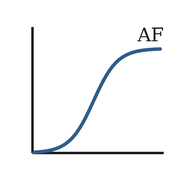
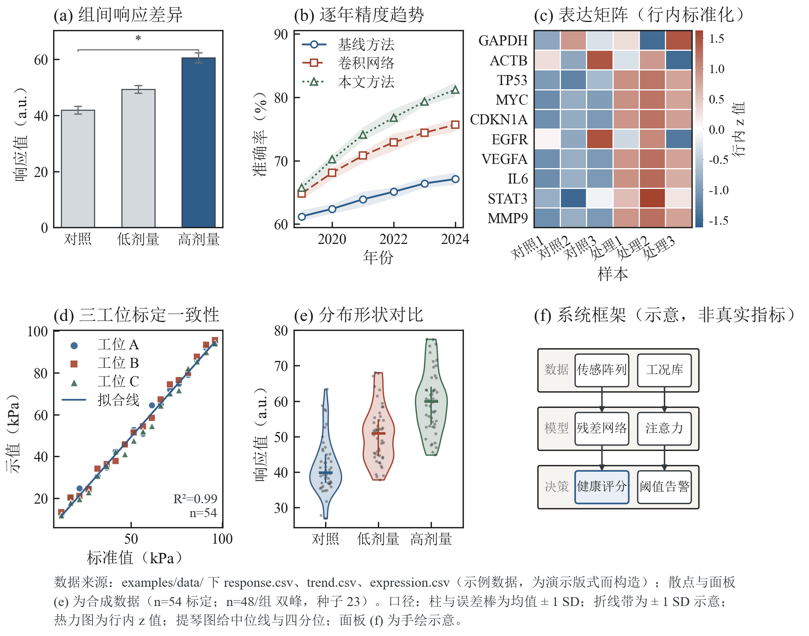
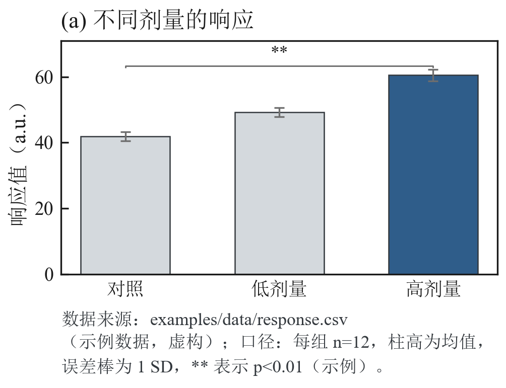
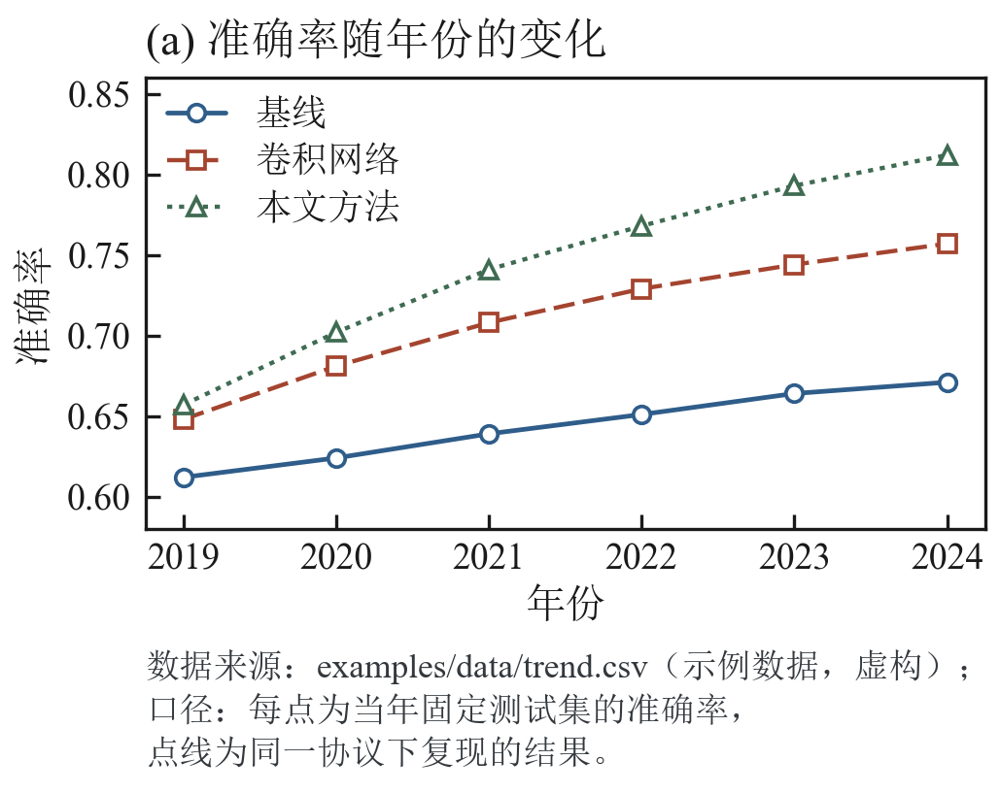
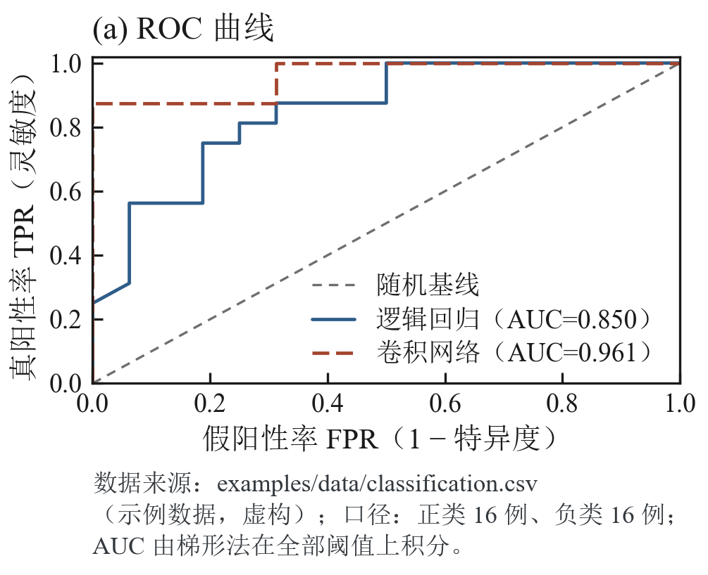
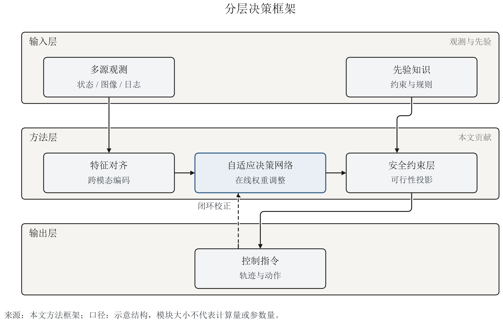

<div align="center">



# academic-figures

**可复现、可投稿的中文论文插图框架 & AI Agent Skill**

白纸 · 墨线 · 细框 · 低饱和语义色 · 300 dpi PNG + 矢量 PDF 双出

[](https://github.com/pordlm/py-academic-fig-skill/actions/workflows/ci.yml)
[](pyproject.toml)
[](LICENSE)
[](pyproject.toml)

[快速上手](#30-秒上手) · [安装](#安装) · [图表与示意图](#图表与示意图) · [样张展示](#样张展示) · [风格规范](#风格规范) · [CLI 自检](#cli-与出图自检) · [文档](#相关文档)

</div>

---

`academic-figures` 把「论文里要一张图」变成**可复现的 Python 代码**与**符合期刊审美的投稿产物**——克制、清晰、留白充足，像严谨的学术框架图，而不是数据看板或 AI 海报。



> 由 [`examples/render_showcase.py`](examples/render_showcase.py) 直接生成：六面板共用同一套色板、线宽与字体栈，图注统一标明数据来源与统计口径。

---

## 核心特性

- **一键统一样式**：调用一次 `apply_theme()`，后续所有 matplotlib 代码（不限于内置渲染器）自动应用白底、无网格、细框、朝内刻度与低饱和配色。
- **26 个现成渲染器**：内置 **21 种科研数据图**（10 大类）与 **5 种声明式示意图**（架构 / 流程 / 场量 / 几何 / 门限），并保留底层原语以自由绘制任意自定义图表。
- **中文排版不踩坑**：内置跨平台中文字体回退（Windows 优先，兼容 Linux / macOS），图注按渲染宽度自动折行并动态增高画布，静态拦截「中文与 `$...$` 混排变方框」问题。
- **投稿级双出 + 自动体检**：`save()` 同步导出 300 dpi PNG 与嵌入字体的矢量 PDF（可选 SVG），配合 CLI 自检门校验分辨率、栏宽/宽高比、配色、命名与字形完整性，可直接接入 CI。
- **代码库 + AI Skill 双形态**：既可作为独立 Python 包 `pip install`，也可作为带中文提示词库（`prompts/`）与规范手册（`references/`）的 DSH Skill 安装，让 AI 严格按同一标准出图。

---

## 30 秒上手

```python
import matplotlib; matplotlib.use("Agg")          # 无 GUI / 服务器环境必填，须在 pyplot 之前
import academic_fig as afg

afg.apply_theme()                                 # ① 主题：白底、细框、中文字体、300 dpi
fig, ax = afg.paper_fig("single")                 # ② 画布：单栏 3.35 in（双栏用 "double" = 7.0 in）
afg.plots.bar(
    ax, ["对照", "低剂量", "高剂量"], [41, 49, 60],
    errors=[1.6, 2.3, 2.4], highlight=[2],
    ylabel="响应值（a.u.）",
)                                                 # ③ 绘图：仅这一行随图型变化
afg.panel(ax, label="(a)", title="组间响应差异")    # ④ 面板标签与标题
afg.footnote(fig, "数据来源：示例数据；口径：均值 ± 1 SD（n=12）。")  # ⑤ 自动折行图注
paths = afg.save(fig, "fig01_response")           # ⑥ 双出 fig01_response.png + .pdf 并自动体检
```

> **提示**：`save()` 返回的字典同时包含产物路径与诊断字段（`auto_theme`、`font_retrofit`）。遍历输出文件时，请使用 `afg.figure_paths(paths)` 过滤路径键。

### 已有 matplotlib 脚本快速接入

无需重写已有绘图逻辑，只需套用主题、画布与坐标轴原语：

```python
afg.apply_theme()
fig, ax = afg.paper_fig("single")
ax.plot(x, y, color=afg.palette.CATEGORICAL[0], lw=1.0)  # 保留任意原生 matplotlib 调用
afg.style_axes(ax)
afg.panel(ax, xlabel="时间（s）", ylabel="响应（a.u.）")
afg.footnote(fig, "数据来源：…；口径：…")
afg.save(fig, "fig02_custom")
```

---

## 安装

环境要求：**Python ≥ 3.10**，核心依赖仅 `numpy` 与 `matplotlib`（`pandas` 可选，安装后支持直接传入 DataFrame）。作为 DSH Skill 安装时，要求 **DSH ≥ 0.2.0**（含 0.2.0-rc 起的全部预发布与后续 0.3.x；已在 `package.json` 的 `engines.dsh = ">=0.2.0-0"` 中显式声明，不再从 `peerDependencies` 反推）。

| 安装方式 | 适用场景 | 包含内容 |
| --- | --- | --- |
| **`dsh plugin add`** | 给 DSH / AI Agent 装技能 | `SKILL.md` + `prompts/` + `references/` + 源码（Python 依赖需另装） |
| **`pip install`** | 在 Python 项目中直接调用 | `academic_fig` 包 + `afig` 命令（约 1 MB，不含提示词与样张资产） |
| **`install_skill.py`** | 本地离线安装 / 边改边用 | 完整技能目录复制到 `.dsh/skills/academic-figures`（支持软链接） |

> `pip install` 与技能安装互不冲突，可同时使用。

### 1. 作为 DSH Skill 插件安装（推荐给 AI 使用）

```bash
dsh plugin add https://github.com/pordlm/py-academic-fig-skill
pip install numpy matplotlib   # 如需传入 DataFrame 可追加 pandas
```

### 2. 作为 Python 包安装（推荐给脚本使用）

```bash
pip install git+https://github.com/pordlm/py-academic-fig-skill
# 或本地开发安装：pip install -e .

afig list                      # 验证命令行可用
```

### 3. 使用本地安装脚本

```bash
python scripts/install_skill.py                 # 复制安装到上级目录的 .dsh/skills/academic-figures
python scripts/install_skill.py --dry-run       # 仅预览安装与清理计划，不写盘
python scripts/install_skill.py --force         # 升级旧安装（原地覆盖并按清单清理陈旧文件）
python scripts/install_skill.py --junction      # 链接安装（Windows junction / POSIX symlink，改源码即生效）
python scripts/install_skill.py --target ~/.dsh/skills/academic-figures   # 指定用户级目录
```

---

## 图表与示意图

### 数据图：21 个渲染器 / 10 大类

所有数据图渲染器采用统一调用方式——传入 `ax` 则绘制在指定子图上，省略则自动创建画布，均返回 `ax`（支持位置参数或 `data={...}`）：

```python
ax = afg.plots.line(ax, years, series, ylabel="准确率（%）")
ax = afg.plots.line(years, series)     # 自动创建画布，可通过 ax.figure 获取 Figure
```

<!-- cat-table:start -->
| 大类 | 渲染器 | 提示词 | 用来画什么 |
|---|---|---|---|
| 比较与组成 | `bar` `grouped_bar` `stacked_bar` `lollipop` | `prompts/30_cat_compare.md` | 比较与组成类 |
| 趋势与时序 | `line` `area` | `prompts/30_cat_trend.md` | 趋势与时间序列类 |
| 分布与描述统计 | `violin` `box` `hist` | `prompts/30_cat_dist.md` | 分布与描述统计类 |
| 关系与回归 | `scatter` `corr` | `prompts/30_cat_relation.md` | 关系与回归类 |
| 假设检验与 Meta | `forest` | `prompts/30_cat_inference.md` | 假设检验与 Meta 分析类 |
| 机器学习与模型评估 | `roc` `pr` `confusion` | `prompts/30_cat_ml.md` | 机器学习与模型评估类 |
| 降维与多维 | `pca` `radar` | `prompts/30_cat_dimred.md` | 降维与聚类类 |
| 临床与生存分析 | `km` | `prompts/30_cat_clinical.md` | 临床医学与生存分析类 |
| 组学与生物信息 | `volcano` `heatmap` | `prompts/30_cat_omics.md` | 生物信息与组学类 |
| 流程与流向 | `sankey` | `prompts/30_cat_flow.md` | 流程与网络类 |
<!-- cat-table:end -->

### 示意图：5 个声明式渲染器

示意图由纯 `dict` / JSON 描述结构，自动计算版式与防重叠尺寸（自行创建画布，不接受 `ax` 参数，返回 `ax` 供 `afg.save(ax.figure, ...)` 导出）。完整参数说明见 [`references/diagram-spec-fields.md`](references/diagram-spec-fields.md)，最小 JSON 样例见 `examples/data/diagrams/`。

| 类型 | 入口 API | 适用场景 | 示例脚本 |
| --- | --- | --- | --- |
| 框架与结构 | `afg.diagrams.architecture(spec, width="double")` | 分层方法框架、系统模块与数据流 | `examples/data/diagrams/arch_layers.json` |
| 流程与时序 | `afg.diagrams.flow(spec)` | 纵向/横向流程、泳道、条件分支与回流 | `examples/data/diagrams/flow_vertical.json` |
| 场量与响应面 | `afg.diagrams.field(spec, kind="surface3d")` | 填色等高线、三维曲面、空间场分布 | `examples/data/diagrams/field_gaussian.json` |
| 几何与覆盖 | `afg.diagrams.geometry(spec)` | 可达范围、站点覆盖、等比例几何示意 | `examples/data/diagrams/geometry_coverage.json` |
| 门限与权衡 | `afg.diagrams.gate(spec)` | 帕累托前沿、阈值扫描、多指标鲁棒性带 | `examples/data/diagrams/gate_pareto.json` |

```python
import json, academic_fig as afg

afg.apply_theme()
spec = json.load(open("examples/data/diagrams/arch_layers.json", encoding="utf-8"))
ax = afg.diagrams.architecture(spec, width="double", note="数据来源：自绘；口径：模块仅表层级关系")
afg.save(ax.figure, "fig05_framework")
```

<details>
<summary><strong>展开查看全谱系图表词典覆盖度（14 大类 / 约 200 种图）</strong></summary>

<br>

没有专用渲染器不代表无法绘制：`apply_theme()` + `style_axes(ax)` 可兜底其余所有 matplotlib 图形。第 13 类（显微/影像等位图本身）与第 14 类（科研三线表）不在本框架职责范围内，详见 [`references/why-not-native-png.md`](references/why-not-native-png.md)。

<!-- coverage-table:start -->
| 词典大类 | 直接支持 | 没有专属渲染器时怎么办 |
|---|---|---|
| 1 基础比较与组成 | bar · grouped_bar · stacked_bar · lollipop | 帕累托/瀑布/环形等手写，`style_axes` 兜底 |
| 2 趋势与时间序列 | line · area | 阶梯/事件图/甘特用 `line(step=…)` 或手写 |
| 3 数据分布与描述统计 | violin · box · hist | ECDF/雨云/山脊用 `hist`/`violin` 组合或手写 |
| 4 变量关系与回归 | scatter · corr | 气泡/Hexbin/Q-Q 手写（`scatter` 换 marker 大小即可） |
| 5 假设检验与 Meta | forest | 漏斗图/系数图手写（`annotate_point` + `refline`） |
| 6 机器学习与模型 | roc · pr · confusion | 校准/学习曲线/特征重要性手写（`line` + `bar`） |
| 7 多维与降维 | pca · radar | 碎石图/平行坐标/树状图手写；t-SNE/UMAP 传入二维坐标即可 |
| 8 临床与生存 | km | 游泳道/累积发病率手写；PRISMA 用 `diagrams.flow` |
| 9 组学与生物信息 | volcano · heatmap | MA/曼哈顿/UpSet 手写（`scatter` + 阈值线） |
| 10 流程与网络 | sankey · diagrams.flow · diagrams.architecture | DAG/拓扑网络手写（`diagrams.flow` 加边） |
| 11 空间与连续场 | diagrams.field | 填色等高线/quiver/3D/三元图手写（matplotlib 原生 + `style_axes`） |
| 12 物理化材实验 | —（通用三件套） | 光谱/XRD/I-V/Nyquist/Bode 都是 `line`，套 `paper_fig` 即可 |
| 13 图像型科研结果 | 不支持（位图是数据本身） | 按 `references/why-not-native-png.md` 嵌入矢量排版 |
| 14 科研表格 | 不支持（不是图） | 用 Word/LaTeX 三线表；本 skill 只出图 |
<!-- coverage-table:end -->

</details>

---

## 样张展示

以下 8 张图全部由本框架直接渲染，未经任何后期修图，均附带同名矢量 PDF（位于 [`assets/atlas/`](assets/atlas/)）：

| | |
| :---: | :---: |
| <br>**分组比较** — 误差棒 + 显著性括号 + 单柱强调 | <br>**多序列趋势** — 线型区分 + ±1 SD 置信带 |
| <br>**分布形状** — 小提琴 + 抖动散点 + 四分位 | <br>**关系与回归** — 背景点云 + 分组 + 拟合线 |
| <br>**模型评估** — ROC 曲线 + AUC 图例 + 对角参考线 | <br>**表达矩阵** — 行内 z-score + 双向发散色阶 |
| <br>**生存曲线** — 阶梯曲线 + 删失刻度 + 风险人数表 | <br>**系统框架图** — 白纸墨线 + 低饱和核心强调 |

---

## 风格规范

`paper-calm` 视觉规范由代码强制保证，无需手动调参：

| 维度 | 规范取值 | 对应接口 |
| --- | --- | --- |
| 画布背景 | 纯白 `#FFFFFF`，无背景网格、无阴影 | `apply_theme()` |
| 坐标轴框 | 四边封闭、0.8 pt、墨色 `#1A1A1A` | `style_axes(ax)` |
| 刻度 | 朝内（主刻度 3.5 pt / 次刻度 2.0 pt），刻度标签 9 pt | `style_axes(ax)` |
| 字号阶梯 | 标题 11 pt（不加粗）· 轴标签 10 pt · 刻度/图例 9 pt · 图注 8.5 pt | `typography.TEXT_SIZES` |
| 期刊栏宽 | 单栏 3.35 in / 双栏 7.0 in，合规宽高比 0.6–2.6 | `paper_fig()` / `save()` |
| 语义配色 | 仅使用 `palette.py` 语义色与色阶；禁用 `tab10` / `jet` / `rainbow` | `palette` / `checks.py` |
| 图例 | 无边框、9 pt、`labelspacing=0.35`，自动避让数据点与文字 | `legend(ax, loc="auto")` |
| 导出格式 | PNG 300 dpi + PDF（`fonttype=42` 嵌入字体，可选 SVG `fonttype=none`） | `save()` |

---

## 核心 API 速查

| 接口 | 签名 | 说明 |
| --- | --- | --- |
| `apply_theme` | `(palette="paper-calm", cjk=True, font_size=10)` | 配置全局 `rcParams`（配色、字体栈、字号与导出参数） |
| `paper_fig` | `(width="single", height=None, nrows=1, ncols=1, **kw)` | 按期刊栏宽与安全宽高比创建 `(fig, axes)` |
| `panel` | `(ax, label="(a)", title=None, xlabel=None, ylabel=None)` | 统一设置面板编号、标题与坐标轴标签（幂等） |
| `footnote` | `(fig, text, **kw)` | 按渲染宽度自动折行并在必要时增高画布 |
| `save` | `(fig, base, formats=("png", "pdf"), dpi=300)` | 双格式导出并执行写盘后基础体检 |
| `figure_paths` | `(save_result)` | 从 `save()` 返回字典中提取纯文件路径字典 |
| `palette` | 模块 | 语义色、分类色、`tint()` 及顺序/发散/离散色阶（`cmap_seq` / `cmap_div` / `cmap_disc`） |

<details>
<summary><strong>更多图元、自检接口与兼容别名</strong></summary>

- **排版与标注原语**：`style_axes`、`axes`、`legend`、`refline`、`reference_circle`、`threshold`、`annotate_point`、`shade_region`、`square`、`grid_axes`、`panel_note`、`save_all`
- **程序化自检**：`check_dir`、`check_script`、`check_text`、`has_errors`、`Issue`
- **栏宽常量**：`SINGLE = 3.35`、`DOUBLE = 7.0`、`WIDTHS`
- **旧版兼容别名**：`set_paper_style → apply_theme`、`save_paper_figure → save`、`footnote_wrapped → footnote`、`panel_result → panel_note`、`plot_reference_circle → reference_circle`

</details>

---

## CLI 与出图自检

安装 Python 包后可直接使用 `afig` 命令（或通过 `python -m academic_fig.cli` 调用）：

```bash
# 查看全部内置图型或按大类筛选
afig list
afig list --category ml

# 生成可直接运行的起步脚本（含完整五步模板）
afig init --example roc --out demo/

# 对输出目录执行投稿体检（退出码 0 通过 / 1 存在 error，可直接接入 CI）
afig check --dir examples/out --strict
afig check --dir examples/out --script make_figs.py --json
```

**自检覆盖项**：
- **图像产物检查**：宽高比（0.6–2.6）、PNG 分辨率（≥ 300 dpi）、同名矢量 PDF 是否齐全、像素级配色合规性、`figNN_名称` 命名规范。
- **脚本静态检查**（目录内含 `.py` 或通过 `--script` 指定时启用）：是否调用 `apply_theme()`、是否误用禁用色表、字号是否越界、中文与 `$...$` 混排检测、真实字形缺失探针，以及是否覆写了无中文字形的 `font.family`。

> 纯图目录仅校验产物项（结论行标记 `△` 表示静态项未检查）；同时传入生成脚本并全部通过时标记 `✓`。

---

## AI Skill 与项目结构

`prompts/` 目录为大模型提供按图类拆分的中文出图规范，`prompts/index.json` 为机读索引，将「图类 → 提示词文件 → 对应 API」动态关联：

```python
import json

idx = {it["category"]: it for it in json.load(open("prompts/index.json", encoding="utf-8"))}
entry = idx["ml"]
print(entry["file"], entry["api"])  # prompts/30_cat_ml.md  ['academic_fig.plots.roc', ...]
```

<details>
<summary><strong>查看仓库目录结构</strong></summary>

```text
py-academic-fig-skill/
├── SKILL.md                  # AI Skill 入口（触发条件、工作流与风格红线）
├── academic_fig/             # Python 框架核心（仅依赖 numpy + matplotlib）
│   ├── palette.py            # 冻结色板与色阶定义
│   ├── typography.py         # 跨平台字体回退、字号白名单与混排检查
│   ├── style.py              # apply_theme / style_axes / legend / 标注原语
│   ├── layout.py             # paper_fig / grid_axes / panel / footnote
│   ├── export.py             # 多格式导出与写盘后体检
│   ├── checks.py             # 结构化 Issue 自检引擎
│   ├── cli.py                # afig 命令行入口
│   ├── plots/                # 21 个数据图渲染器 + base 原语
│   └── diagrams/             # 5 个声明式示意图渲染器
├── prompts/                  # 22 份中文提示词 + index.json 机读索引
├── references/               # 期刊规格、中文排版、雷区清单、选图路由与 R 对照
├── examples/                 # render_plots / render_diagrams / render_showcase 与演示数据
├── assets/                   # 风格样张 style_preview.png + atlas/ 精选参考图
├── scripts/                  # 安装脚本、文档零漂移核对与提示词骨架验证
└── docs/                     # 架构说明与图表词典
```

</details>

---

## 常见问题与使用边界

<details>
<summary><strong>中文显示成方框怎么办？（含 macOS / Linux 字体说明）</strong></summary>

1. 确保 `afg.apply_theme()` 在创建 `Figure` **之前**调用。
2. 运行 `python -c "import academic_fig as afg; print(afg.typography.font_status())"` 查看实际命中的字体文件。
3. 若 `cjk` 为空（常见于精简 Linux 容器或部分 macOS 环境），安装 Noto CJK 字体即可：
   - **macOS**：`brew install --cask font-noto-serif-cjk-sc`
   - **Ubuntu / Debian**：`sudo apt install fonts-noto-cjk`

</details>

<details>
<summary><strong>为什么带 `$R^2$` 的中文标签整段变成了方框？</strong></summary>

matplotlib 的 mathtext 引擎仅含 ASCII 字形，`$...$` 内部不能出现汉字。建议直接改用 Unicode（如 `R²`），或调用 `afg.typography.text_safety(text)["rewritten"]` 自动改写。

</details>

<details>
<summary><strong>如何避免图例压住数据点或长图注被裁切？</strong></summary>

- **图例避让**：使用 `afg.legend(ax, loc="auto")`，它会对四角进行点数与文字重叠打分，必要时自动移至框外；极端密集散点图可手动指定 `loc` 或 `bbox_to_anchor`。
- **长图注**：使用 `afg.footnote(fig, text)`，它会按实际渲染宽度自动折行并在需要时增高画布，保持绘图区比例不变。

</details>

<details>
<summary><strong>如何导出可再编辑的 SVG？</strong></summary>

调用 `afg.save(fig, "fig03_x", formats=("png", "pdf", "svg"))`，SVG 默认使用 `fonttype=none` 以保留可编辑文本对象。

</details>

**明确边界**：
- **不做统计计算**：显著性检验、置信区间、AUC 等统计量需预先计算后传入，框架只负责严谨呈现。
- **配色自检基于 `paper-calm`**：像素色距校验针对默认语义色体系；若使用自定义期刊色值（如 `journal-cns` 覆盖的 `prop_cycle`）或混入照片素材，配色检查会按越界色告警。
- **架构图最小高度保护**：`diagrams.architecture()` 会预计算布局高度，画布过矮时直接报错而非绘制重叠节点。
- **示例数据仅用于演示**：`examples/data/` 均为物理合理但非真实实验的合成数据。

---

## 相关文档

- [SKILL.md](SKILL.md) — AI Skill 入口：铁律、选图路由与五步工作流
- [references/journal-specs.md](references/journal-specs.md) — 期刊栏宽、字号与导出格式对照
- [references/typography-cjk.md](references/typography-cjk.md) — 中文字体回退与混排避坑指南
- [references/palette-role.md](references/palette-role.md) — 色板语义分工与色阶选用
- [references/figure-routing.md](references/figure-routing.md) — 从研究结论反推最合适的图型
- [references/pitfalls.md](references/pitfalls.md) — 高频论文绘图塌陷点清单（P-01 … P-14）
- [references/r-cheatsheet.md](references/r-cheatsheet.md) — ggplot2 到 `academic_fig` 的写法对照
- [references/why-not-native-png.md](references/why-not-native-png.md) — 为什么不让 AI 直接生成论文位图
- [docs/ARCH.md](docs/ARCH.md) / [docs/图表词典.md](docs/图表词典.md) — 框架架构与 14 大类图表词典

---

## 许可证与致谢

本项目以 **GNU General Public License v3.0 or later（GPL-3.0-or-later）** 开源发布，全文见 [LICENSE](LICENSE)。

- **上游致谢**：`academic_fig/checks.py` 中的部分质量检查思路改写并整合自一份以 **Apache-2.0** 许可发布的第三方科研绘图 QA 工具（Apache-2.0 与 GPLv3 兼容），按协议保留其来源署名并随本仓库整体以 GPL-3.0-or-later 发布。
- **规范文本复用**：若仅在闭源项目中参考本仓库的风格约定与提示词文本（`SKILL.md`、`prompts/`、`references/`，不含代码），请在致谢中注明出处。
